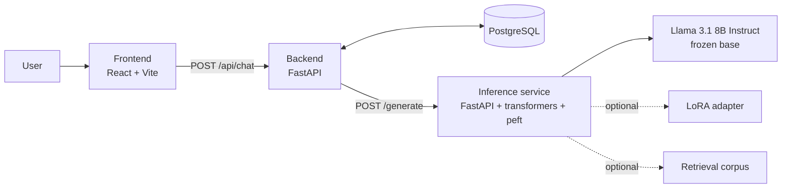
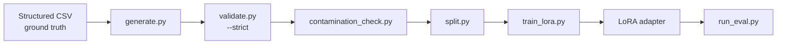

# RAGA: Raga-Aware Generative Assistant

RAGA is a research and demonstration system that reduces confident fabrication in a large language model answering questions about Hindustani classical music. It fine-tunes Llama 3.1 8B Instruct with LoRA on a small, verified instruction dataset, and measures the effect with paired fabrication and over-refusal metrics.

## Contents

- [Motivation](#motivation)
- [Project status](#project-status)
- [System overview](#system-overview)
- [Repository layout](#repository-layout)
- [Getting started](#getting-started)
- [Configuration](#configuration)
- [Pipelines](#pipelines)
- [Documentation](#documentation)
- [Attribution](#attribution)

## Motivation

General-purpose LLMs answer questions about ragas with the same fluency they bring to well-represented topics, including when the answer is wrong. Facts such as a raga's vadi, samvadi, thaat, or aroha/avaroha are precise and verifiable, yet sparsely represented in pretraining data. The model rarely says it does not know; it produces a plausible but incorrect answer.

RAGA addresses this by:

1. Measuring the base model's fabrication rate on unanswerable questions.
2. Training a LoRA adapter on verified data that includes calibrated refusals.
3. Verifying that the improvement does not come from over-refusal, by reporting both rates together.

## Project status

| Milestone | Scope | Status |
|---|---|---|
| M1 | Baseline and decoding-parameter study | Complete |
| M2 | Dataset construction pipeline | Complete |
| M3 | LoRA fine-tuning | Designed, not yet executed |
| M4 | Four-condition evaluation | Designed, not yet executed |
| M5 | RAGA application (frontend, backend, inference service) | In progress |

No fine-tuned-model results are reported yet. The evaluation harness fails explicitly for conditions that are not available rather than producing placeholder numbers. See [docs/PRD.md](docs/PRD.md) for the full release plan.

## System overview



The backend holds no model weights and requires no GPU. The inference service is the only component that loads the model, so the serving condition (baseline, few-shot, RAG, fine-tuned) can change without touching the backend or frontend.

## Repository layout


| Path | Purpose |
|---|---|
| `docs/` | Product requirements, architecture, and workflow documentation |
| `backend/` | FastAPI application: chat API, conversation service, persistence |
| `inference-service/` | FastAPI model server: base model, optional LoRA adapter, fixed decoding configuration |
| `frontend/` | React, TypeScript, Vite, and Tailwind chat interface |
| `dataset/` | Structured ground truth, generation, validation, contamination check, and splitting |
| `finetuning/` | LoRA training script, hyperparameter configuration, and evaluation harness |
| `infra/` | Environment variable templates |

## Getting started

### Prerequisites

| Component | Requirement |
|---|---|
| Application stack (backend, frontend, database) | Docker and Docker Compose; 8 GB RAM; no GPU |
| Inference service and fine-tuning | NVIDIA GPU with approximately 25 GB VRAM; Python 3.10 or later |
| Dataset pipeline | Python 3.10 or later; CPU only |

### Application stack (no GPU)

```bash
cp infra/.env.example infra/.env
docker compose --env-file infra/.env up --build db backend frontend
```

| Service | URL |
|---|---|
| Frontend | http://localhost:5173 |
| Backend API | http://localhost:8000 |
| Backend health check | http://localhost:8000/health |

With `USE_MOCK_INFERENCE=true` (the default) the backend returns a mock response, so the full application can be developed and tested without a GPU.

### Inference service (GPU host)

```bash
cd inference-service
pip install -r requirements.txt
uvicorn app.main:app --host 0.0.0.0 --port 8001
```

Then set `USE_MOCK_INFERENCE=false` and point `INFERENCE_SERVICE_URL` at this host in `infra/.env`.

### Dataset pipeline (CPU)

```bash
cd dataset
python scripts/generate.py
python scripts/validate.py --strict
python scripts/contamination_check.py
python scripts/split.py
```

### Fine-tuning (GPU host)

```bash
cd finetuning
python train_lora.py --config configs/lora_config.yaml
```

### Evaluation

```bash
cd finetuning/eval
python run_eval.py --inference-url http://localhost:8001 --condition baseline
```

Supported conditions are `baseline`, `few_shot`, `rag`, and `finetuned`. The `rag` and `finetuned` conditions return an explicit error until the retrieval corpus and adapter exist.

## Configuration

Settings are read from `infra/.env` (template: `infra/.env.example`).

| Variable | Used by | Description | Default |
|---|---|---|---|
| `DATABASE_URL` | backend | PostgreSQL connection string | `postgresql://raga:raga@db:5432/raga` |
| `USE_MOCK_INFERENCE` | backend | Return mock responses instead of calling the inference service | `true` |
| `INFERENCE_SERVICE_URL` | backend | Base URL of the inference service | `http://inference-service:8001` |
| `DEFAULT_SERVING_CONDITION` | backend | One of `baseline`, `few_shot`, `rag`, `finetuned` | `baseline` |
| `BASE_MODEL_ID` | inference service | Hugging Face model identifier | `NousResearch/Meta-Llama-3.1-8B-Instruct` |
| `LORA_ADAPTER_PATH` | inference service | Path to a trained adapter; leave empty until training has run | empty |

The default database credentials are for local development only and must be changed before any shared deployment. CORS is currently open (`*`) and should be restricted likewise.

## Pipelines



Each stage is a hard gate. Unverified records cannot reach the training split, and evaluation probes cannot leak into it. Details are in [docs/WORKFLOW.md](docs/WORKFLOW.md).

## Documentation

| Document | Contents |
|---|---|
| [docs/PRD.md](docs/PRD.md) | Problem, goals, requirements, success metrics, release plan |
| [docs/ARCHITECTURE.md](docs/ARCHITECTURE.md) | Layering, service boundaries, technology stack, risks |
| [docs/WORKFLOW.md](docs/WORKFLOW.md) | Dataset, training, evaluation, and runtime workflows |
| [dataset/docs/CONVENTIONS.md](dataset/docs/CONVENTIONS.md) | Frozen dataset conventions enforced by the validator |

## Attribution

- Base model: Meta Llama 3.1 8B Instruct, served through the `NousResearch` ungated mirror pending Meta gated-repository approval. Use is subject to the Llama 3.1 Community License.
- Musicological ground truth: Bor, J. and Rao, S., *The Raga Guide*.
