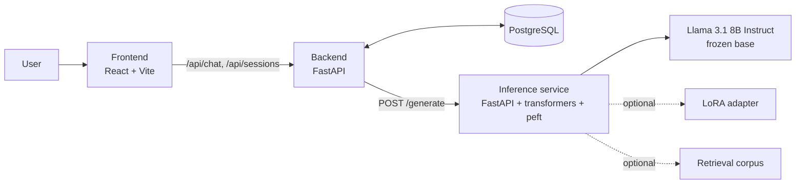
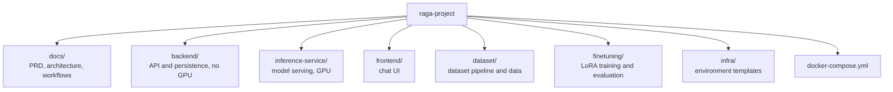
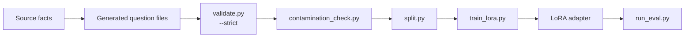

# RAGA: Raga-Aware Generative Assistant

RAGA is a research and demonstration system that reduces confident fabrication in a large language model answering questions about Hindustani classical music. It fine-tunes Llama 3.1 8B Instruct with LoRA on a small, verified instruction dataset, and measures the effect with paired fabrication and over-refusal metrics. It includes a chat application for exploring the model's answers.

## Contents

- [Features](#features)
- [Motivation](#motivation)
- [Project status](#project-status)
- [System overview](#system-overview)
- [Repository layout](#repository-layout)
- [Getting started](#getting-started)
- [Configuration](#configuration)
- [API reference](#api-reference)
- [Frontend](#frontend)
- [Dataset](#dataset)
- [Known limitations](#known-limitations)
- [Pipelines](#pipelines)
- [Documentation](#documentation)
- [Attribution](#attribution)

## Features

### Chat application

- **Conversation:** Markdown answers (headings, lists, tables, links, syntax-highlighted code), an auto-growing composer (Enter sends, Shift+Enter adds a line), a thinking indicator, and a stop button that cancels the in-flight request.
- **Message actions:** copy an answer, regenerate the latest answer, and edit an earlier question and resubmit it. Both replace the affected turn on the server, and a failed attempt leaves the conversation unchanged.
- **Error handling:** specific, dismissible messages for an unreachable backend, timeouts, server errors, and malformed responses. A failed send keeps what you typed and offers Retry. Failed requests are never replaced with mock responses.
- **Conversation history:** grouped as Pinned, Today, Yesterday, Last 7 days, and Older. Search matches titles and message content. Each conversation has a menu to rename, pin or unpin, share, or delete (with confirmation).
- **Sharing:** shares the conversation as plain text through the browser's share sheet, or copies it to the clipboard when none is available. It does not create a public link.
- **Layout:** a collapsible sidebar (remembered between visits), a mobile drawer, light and dark themes, and reduced-motion support.
- **Settings:** profile (name, photo, bio, email, musical background, location), theme, keyboard shortcuts, privacy notes, and server status. The profile and theme are stored in the browser only.
- **Evidence components:** a status badge, a key-facts table, and a source list. They render only metadata the API supplies, which it does not yet do (see [Known limitations](#known-limitations)).

### Backend

- Chat and conversation-management API with persistence in PostgreSQL (SQLite for local development).
- Mock inference for development without a GPU, selected only by configuration.
- Clear failure mapping: 422 for invalid input, 502 or 504 when the inference service fails or times out, and 503 when the database is unavailable.
- Startup schema upgrade for databases created by earlier versions (adds missing columns and backfills titles).

### Research pipeline

- A dataset covering ten question categories, including calibrated refusals and context-grounded questions.
- Validation, contamination checking, and a split stratified by fact group.
- A LoRA training script and a four-condition evaluation harness (baseline, few-shot, RAG, fine-tuned).

## Motivation

General-purpose LLMs answer questions about ragas with the same fluency they bring to well-represented topics, including when the answer is wrong. Facts such as a raga's vadi, samvadi, thaat, or aroha/avaroha are precise and verifiable, yet sparsely represented in pretraining data. The model rarely says it does not know; it produces a plausible but incorrect answer.

RAGA addresses this by:

1. Measuring the base model's fabrication rate on unanswerable questions.
2. Training a LoRA adapter on verified data that includes calibrated refusals.
3. Verifying that the improvement does not come from over-refusal, by reporting both rates together.

## Project status

| Milestone | Scope | Status |
|---|---|---|
| M1 | Baseline and decoding-parameter study | Complete |
| M2 | Dataset construction pipeline | Complete |
| M3 | LoRA fine-tuning | Designed, not yet executed |
| M4 | Four-condition evaluation | Designed, not yet executed |
| M5 | RAGA application (frontend, backend, inference service) | Frontend and backend working with mock inference; real inference service not yet connected end to end |

No fine-tuned-model results are reported yet. The evaluation harness fails explicitly for conditions that are not available rather than producing placeholder numbers. See [docs/PRD.md](docs/PRD.md) for the full release plan.

## System overview



The backend holds no model weights and requires no GPU. The inference service is the only component that loads the model, so the serving condition (baseline, few-shot, RAG, fine-tuned) can change without touching the backend or frontend.

## Repository layout



| Path | Purpose |
|---|---|
| `docs/` | Product requirements, architecture, and workflow documentation |
| `backend/` | FastAPI application: chat and session API, conversation service, persistence, tests |
| `inference-service/` | FastAPI model server: base model, optional LoRA adapter, fixed decoding configuration |
| `frontend/` | React, TypeScript, Vite, and Tailwind chat interface, with tests |
| `dataset/` | Structured ground truth, generated question files, splits, validation, contamination check |
| `finetuning/` | LoRA training script, hyperparameter configuration, and evaluation harness |
| `infra/` | Environment variable templates |

## Getting started

### Prerequisites

| Component | Requirement |
|---|---|
| Application stack (backend, frontend, database) | Docker and Docker Compose, or Python 3.10+ and Node.js 20+ to run without Docker; no GPU |
| Inference service and fine-tuning | NVIDIA GPU with approximately 25 GB VRAM; Python 3.10 or later |
| Dataset validation and splitting | Python 3.10 or later; CPU only |

### Application stack with Docker (no GPU)

```bash
cp infra/.env.example infra/.env
docker compose --env-file infra/.env up --build db backend frontend
```

| Service | URL |
|---|---|
| Frontend | http://localhost:5173 |
| Backend API | http://localhost:8000 |
| Backend health check | http://localhost:8000/health |

With `USE_MOCK_INFERENCE=true` (the default) the backend returns a mock response, so the full application can be developed and tested without a GPU. The Docker setup has not been exercised in the current development environment.

### Run without Docker

Both processes must be running. If the backend is stopped, the UI reports that it can't reach the server.

```bash
# terminal 1: backend (uses SQLite via backend/.env; see infra/.env.example for the variables)
cd backend
python -m venv .venv && .venv/Scripts/activate        # macOS/Linux: source .venv/bin/activate
pip install -r requirements.txt
printf 'DATABASE_URL=sqlite:///./raga_dev.db\nUSE_MOCK_INFERENCE=true\n' > .env
uvicorn app.main:app --reload

# terminal 2: frontend
cd frontend
npm install
npm run dev
```

Databases created by earlier versions are upgraded automatically on startup.

### Tests

```bash
cd backend && pip install -r requirements-dev.txt && pytest
cd frontend && npm run typecheck && npm test
```

The backend tests use a temporary SQLite database and cover the chat and session endpoints, error mapping, regenerate and edit, pinning, and the schema upgrade. The frontend tests cover the composer, home screen, sidebar and conversation menu, message actions, evidence components, API error handling, and the main application flows. The project has no lint configuration.

### Inference service (GPU host)

```bash
cd inference-service
pip install -r requirements.txt
uvicorn app.main:app --host 0.0.0.0 --port 8001
```

Then set `USE_MOCK_INFERENCE=false` and point `INFERENCE_SERVICE_URL` at this host in `infra/.env`. The inference service has no authentication; do not expose it publicly.

### Fine-tuning (GPU host)

```bash
cd finetuning
python train_lora.py --config configs/lora_config.yaml
```

The training script has not been run yet.

### Evaluation

```bash
cd finetuning/eval
python run_eval.py --inference-url http://localhost:8001 --condition baseline
```

Supported conditions are `baseline`, `few_shot`, `rag`, and `finetuned`. The `rag` and `finetuned` conditions return an explicit error until the retrieval corpus and adapter exist.

## Configuration

Settings are read from `infra/.env` (template: `infra/.env.example`), or from `backend/.env` when running without Docker.

| Variable | Used by | Description | Default |
|---|---|---|---|
| `DATABASE_URL` | backend | Database connection string (PostgreSQL, or SQLite for local development) | `postgresql://raga:raga@db:5432/raga` |
| `USE_MOCK_INFERENCE` | backend | Return mock responses instead of calling the inference service | `true` |
| `INFERENCE_SERVICE_URL` | backend | Base URL of the inference service | `http://inference-service:8001` |
| `DEFAULT_SERVING_CONDITION` | backend | One of `baseline`, `few_shot`, `rag`, `finetuned` | `baseline` |
| `CORS_ORIGINS` | backend | Comma-separated browser origins allowed to call the API | `http://localhost:5173,http://127.0.0.1:5173` |
| `API_PROXY_TARGET` | frontend dev server | Where the dev server proxies `/api` and `/health` | `http://localhost:8000` (`http://backend:8000` in Docker) |
| `BASE_MODEL_ID` | inference service | Hugging Face model identifier | `NousResearch/Meta-Llama-3.1-8B-Instruct` |
| `LORA_ADAPTER_PATH` | inference service | Path to a trained adapter; leave empty until training has run | empty |

The default database credentials are for local development only and must be changed before any shared deployment. Set `CORS_ORIGINS` to the real origin when deploying.

## API reference

| Method and path | Purpose |
|---|---|
| `GET /health` | Status, whether mock inference is on, and the serving condition |
| `POST /api/chat` | Send `{ session_id?, message, replace_from_turn? }`; returns the answer and its metadata |
| `GET /api/sessions?q=` | List conversations that have at least one turn: pinned first, then by recent activity. `q` searches titles and message content |
| `GET /api/sessions/{id}` | One conversation with all of its turns |
| `PATCH /api/sessions/{id}` | Update `{ title?, pinned? }`; send at least one |
| `DELETE /api/sessions/{id}` | Delete a conversation and its turns |

`replace_from_turn` is a zero-based turn index used for regenerate and edit. The model sees only the turns before it, and on success that turn and every later turn are replaced by the new one. If generation fails the conversation is unchanged.

Errors return a JSON `detail`. Invalid input returns 422. An inference failure returns 502, a timeout 504, and an unreachable database 503.

## Frontend

React 18, TypeScript, Vite, and Tailwind CSS, with Lucide icons, `react-markdown` for answers, and Vitest with Testing Library for tests. There is no router and no state library; conversation state lives in `App.tsx`, API calls in `src/lib/api.ts`, and presentation in `src/components/`.

```bash
cd frontend
npm run dev          # development server on http://localhost:5173
npm run typecheck    # TypeScript check
npm test             # unit and interaction tests
npm run build        # type-check and production build
```

| Shortcut | Action |
|---|---|
| Enter | Send message |
| Shift + Enter | New line |
| Esc | Cancel editing, close menus and dialogs, leave settings |

## Dataset

The question files in `dataset/generated/` and their splits in `dataset/splits/` are git-ignored build output.

| Category | Rows | Category | Rows |
|---|---|---|---|
| raga_facts | 119 | beginner | 66 |
| vadi_samvadi | 152 | advanced | 54 |
| aroha_avaroha | 80 | out_of_domain | 70 |
| comparison | 90 | grounded | 76 |
| terminology | 40 | taal | 18 |

That is 765 rows, split by fact group into 600 train, 68 validation, and 97 test. They cover 22 ragas, 9 terms, and 3 taals, so this is a pilot-scale dataset, not a full one.

- **Verified facts only:** every row is derived from facts in the source table. Facts that failed an internal consistency check, for example a stated jati that contradicts the aroha and avaroha beside it, were left out rather than trained on. Disputed facts are stated as disputed.
- **Refusals:** the `out_of_domain` category teaches calibrated refusal using fictional raga, taal, and term names that do not appear in the evaluation probes.
- **Grounded questions:** the `grounded` category uses the same `Context: ... Question: ...` layout the inference service uses for the RAG condition, including questions whose context lacks the answer.
- **Regeneration:** the script that built these ten category files and its source workbook are not in this repository, so they cannot currently be regenerated from it. `dataset/scripts/generate.py` is the earlier generator: it builds only a small sample from `dataset/structured/*.csv` and writes into the same folder, so do not run it over the current files.
- **Checks:** `python scripts/validate.py --strict` and `python scripts/contamination_check.py` (run from `dataset/`) validate the current files, and `python scripts/split.py` rebuilds the splits.

## Known limitations

- **Evidence metadata:** the API returns no evidence status, key-facts attributes, or source references, so the evidence components show nothing. To use them the API must add an optional `evidence` object to chat responses and turns (`status`: supported, partial, or uncertain; `attributes`: label and value rows; `sources`: title, optional http(s) URL, optional detail). Rows must come from verified records, never from parsing the model's text.
- **Feedback controls:** there is no endpoint or storage for answer feedback, so thumbs up and down are not shown.
- **Conversation previews:** the session summary has no preview field, so the sidebar lists titles only.
- **Streaming and stop:** answers are not streamed. Stop cancels the browser request only; the server may still finish and store the turn.
- **Serving condition:** it is a single backend setting. Settings displays it but cannot change it, and there is no per-conversation model choice.
- **Users:** there is no authentication. All conversations in a backend are visible to every client, and the profile is stored in each browser only.
- **Database migrations:** schema changes are applied by a small startup upgrade, not a migration tool. A tool such as Alembic is the long-term answer. The upgrade has been tested on SQLite; it has not been run against a live PostgreSQL instance.
- **Model work:** fine-tuning and evaluation have not been executed, the RAG retriever is a stub that fails explicitly, and the real inference service has not been connected end to end.

## Pipelines



Each stage is a hard gate. Unverified records cannot reach the training split, and evaluation probes cannot leak into it. Details are in [docs/WORKFLOW.md](docs/WORKFLOW.md).

## Documentation

| Document | Contents |
|---|---|
| [docs/PRD.md](docs/PRD.md) | Problem, goals, requirements, success metrics, release plan |
| [docs/ARCHITECTURE.md](docs/ARCHITECTURE.md) | Layering, service boundaries, technology stack, risks |
| [docs/WORKFLOW.md](docs/WORKFLOW.md) | Dataset, training, evaluation, and runtime workflows |
| [dataset/docs/CONVENTIONS.md](dataset/docs/CONVENTIONS.md) | Frozen dataset conventions enforced by the validator |

## Attribution

- Base model: Meta Llama 3.1 8B Instruct, served through the `NousResearch` ungated mirror pending Meta gated-repository approval. Use is subject to the Llama 3.1 Community License.
- Musicological ground truth: Bor, J. and Rao, S., *The Raga Guide*, and standard Hindustani pedagogy. Some entries were taken from Wikipedia infoboxes and are weaker evidence than a print source.
