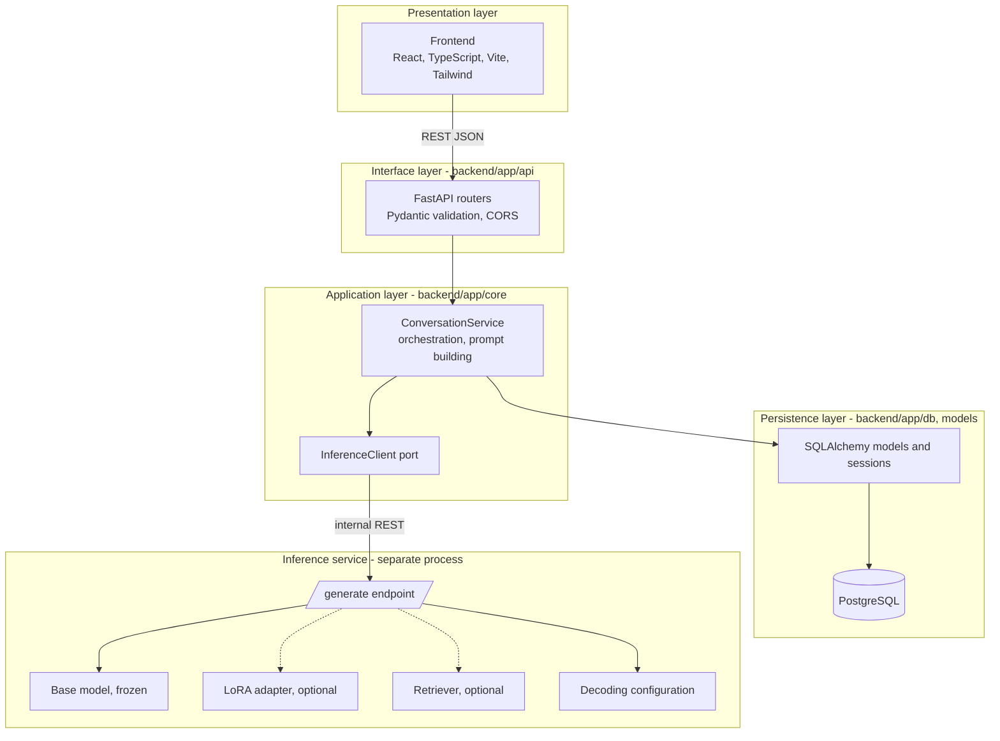
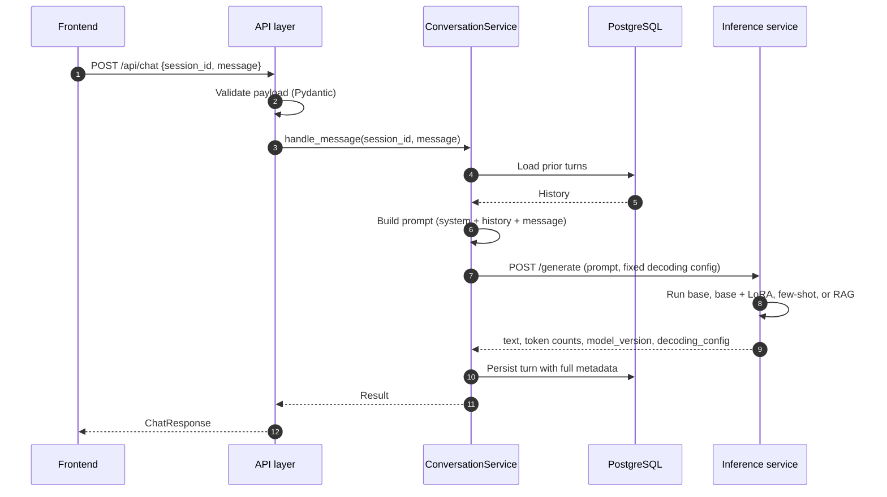
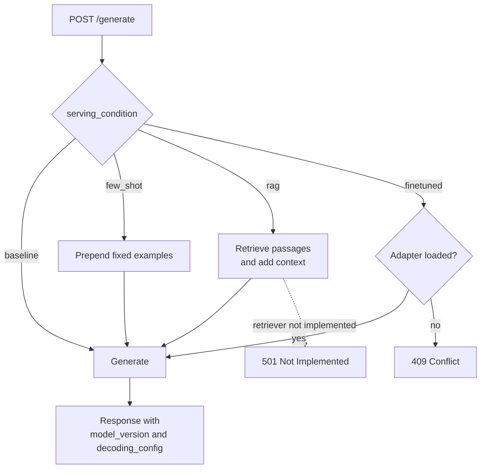

# RAGA Architecture

| | |
|---|---|
| Document | Architecture |
| Status | Draft v1.0 |
| Related | [PRD](PRD.md), [Workflows](WORKFLOW.md) |

## 1. Layering Principle

The system follows the Clean Architecture dependency rule: inner layers never import from outer layers, and dependencies point toward domain logic. The model and the database are treated as replaceable details rather than the center of the design.



## 2. Service Separation

| Concern | Backend | Inference service |
|---|---|---|
| Holds model weights | No | Yes |
| Requires GPU | No | Yes |
| Owns persistence (PostgreSQL) | Yes | No |
| Restartable and replaceable independently | Yes | Yes |
| Target host | 8 GB RAM laptop | GPU host with approximately 25 GB VRAM |

The separation supports a two-hardware development model. The application (frontend, backend, database) is built and tested on a machine without a GPU, using a mock inference client. The inference service is started on the GPU host only when model work begins.

The backend reaches the inference service solely through the `InferenceClient` port over HTTP. Changing the serving model from baseline to fine-tuned is therefore a configuration change, not a code change.

## 3. Chat Request Flow



Every generation persists the model or adapter version and the decoding configuration that produced it. This makes later evaluation auditable from the stored record.

## 4. Serving Conditions

The inference service selects behavior from the `serving_condition` request field.



## 5. Domain Boundaries

- **Backend** knows nothing about model internals. It calls `generate(prompt, config)` and receives text. It does not change between the baseline and fine-tuned milestones.
- **Inference service** knows nothing about conversations, sessions, or PostgreSQL. It is a pure model-serving boundary and is also used directly by the evaluation harness.
- **Dataset pipeline** (`dataset/`) and **fine-tuning** (`finetuning/`) are offline batch processes. Their only contract with the serving system is the LoRA adapter artifact and the retrieval corpus.

## 6. Technology Stack

| Layer | Technology | Rationale |
|---|---|---|
| Frontend | React, TypeScript, Vite, Tailwind CSS | Fast development loop, standard SPA stack, no GPU dependency |
| Backend API | FastAPI (Python) | Async, automatic OpenAPI schema, suited to a small well-defined endpoint surface |
| Inference service | FastAPI, Hugging Face `transformers`, `peft` | Same framework as the backend; `peft` provides LoRA training and loading |
| Database | PostgreSQL 16 | Relational, durable conversation history |
| Containerization | Docker, Docker Compose | Reproducible across both hardware environments |
| Base model | Llama 3.1 8B Instruct (NousResearch mirror) | Open weights, instruction-tuned, fits in 25 GB VRAM at float16 |
| Fine-tuning | LoRA via `peft` | Parameter-efficient; under 1% of parameters trained |

## 7. Decoding Configuration

Decoding settings are defined in one place (`inference-service/app/core/decoding_config.py`) and held constant across baseline and fine-tuned evaluation, so that any measured difference is attributable to the model or adapter.

| Parameter | Value | Note |
|---|---|---|
| `do_sample` | `false` | Greedy decoding for reproducibility |
| `repetition_penalty` | 1.1 | |
| `max_new_tokens` | 220 | Per-category caps are defined for evaluation |
| `seed` | 42 | |
| `temperature`, `top_p`, `top_k` | 1.0, 1.0, 50 | Ignored while sampling is disabled |

## 8. Repository Structure

```text
raga-project/
|-- docs/                    PRD, architecture, workflows
|-- backend/                 FastAPI application
|   `-- app/
|       |-- api/             Routers (interface layer)
|       |-- core/            Services, inference client, configuration
|       |-- models/          SQLAlchemy ORM models
|       |-- schemas/         Pydantic request and response schemas
|       `-- db/              Session management
|-- inference-service/       FastAPI model server
|   `-- app/
|       |-- api/             /generate endpoint
|       |-- core/            Model loader, decoding config, few-shot, retriever
|       `-- models/          Request and response schemas
|-- frontend/                React + Vite + Tailwind chat UI
|-- dataset/                 Offline dataset pipeline
|   |-- structured/          ragas.csv, concepts.csv, taals.csv
|   |-- generated/           Output JSONL per category (git-ignored)
|   |-- splits/              train, val, test splits
|   |-- scripts/             generate, validate, contamination_check, split
|   `-- docs/                CONVENTIONS.md
|-- finetuning/              Offline training and evaluation
|   |-- configs/             LoRA hyperparameters
|   `-- eval/                Probes and evaluation harness
|-- infra/                   Environment templates
`-- docker-compose.yml
```

## 9. Technical Risks and Mitigations

| Risk | Mitigation |
|---|---|
| Overfitting on a dataset of roughly 10,000 to 12,000 examples | Low LoRA rank, held-out validation split, evaluation-loss monitoring |
| Regression on general instruction following | Include a small general-ability sanity probe alongside the music probes |
| RAG surfaces a contested or incorrect passage | Corpus built only from the verified sources used for training; contested facts flagged explicitly |
| Decoding configuration drift between conditions | Single version-controlled definition, logged with every generation |
| GPU host unavailable | Backend and frontend testable against the mock inference client |
| Open CORS and default database credentials | Acceptable for local development only; restrict before any shared deployment |
