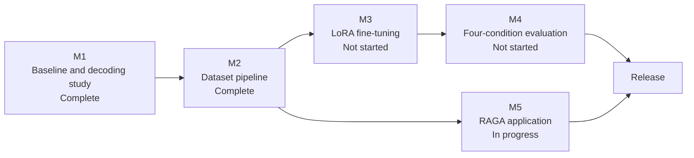

# Product Requirements Document

| | |
|---|---|
| Product | RAGA: Raga-Aware Generative Assistant |
| Status | Draft v1.0 |
| Owner | Project maintainer |
| Last updated | 2026-10-14 |
| Related | [Architecture](ARCHITECTURE.md), [Workflows](WORKFLOW.md) |

## 1. Problem Statement

General-purpose LLMs such as Llama 3.1 8B Instruct answer questions about Hindustani classical music with the same fluent confidence they bring to well-represented topics, including when they are wrong. Facts such as a raga's vadi (dominant note), samvadi, thaat (parent scale), or aroha/avaroha are precise and verifiable but thinly represented in web-scale pretraining data. When asked about a raga it has not reliably learned, the model does not decline; it produces a plausible, well-formed, incorrect answer.

The fluency is what makes this harmful: a student with no independent way to verify the answer has no signal that anything is wrong.

## 2. Goals

| ID | Goal |
|---|---|
| G1 | Measure how often the base model fabricates rather than refuses on unanswerable musicological questions |
| G2 | Reduce the fabrication rate through LoRA fine-tuning on a small, verified instruction dataset |
| G3 | Ensure the reduction does not come at the cost of over-refusal on answerable questions |
| G4 | Deliver a working chat application that demonstrates the behavior end to end |
| G5 | Produce a dataset-construction methodology that generalizes to other low-resource domains |

## 3. Non-Goals

- A general-purpose music chatbot covering Carnatic music, Western theory, or audio analysis.
- Training from scratch. The work is parameter-efficient fine-tuning on a frozen pretrained base.
- Multi-user authentication, billing, or production-scale infrastructure. This is a research and demonstration artifact.
- An exhaustive account of the raga system. The dataset is scoped to one verified reference (Bor and Rao, *The Raga Guide*) plus targeted extensions.

## 4. Personas

| Persona | Priority | Need |
|---|---|---|
| Music student | Primary | Trustworthy answers while learning; the system must say it is unsure rather than invent facts |
| Evaluator or faculty | Secondary | Measured, reproducible evidence that fine-tuning changed model behavior |
| Researcher | Secondary | A dataset pipeline and evaluation harness reusable in a different low-resource domain |

## 5. User Stories

1. As a student, I can ask about a raga and receive an answer or a clear statement that the system is not sure.
2. As a student, I can ask about a raga that does not exist and be told so, rather than receive invented details.
3. As an evaluator, I can see fabrication rate and over-refusal rate side by side, to tell real improvement from blanket refusal.
4. As a researcher, I can re-run validation and contamination checks on new data and trust that unverified content is blocked.
5. As a developer, I can swap the serving model (base, LoRA-adapted, RAG-augmented) without changing the frontend or backend.

## 6. Functional Requirements

| ID | Requirement |
|---|---|
| FR1 | The chat interface accepts a free-text question and returns a generated answer |
| FR2 | The backend persists conversation history per session in PostgreSQL |
| FR3 | The inference service loads the base model and, optionally, a LoRA adapter, and serves generations under a fixed, logged decoding configuration |
| FR4 | The inference service supports a RAG mode that retrieves top-k passages from a verified corpus and conditions generation on them |
| FR5 | The dataset pipeline generates instruction/output pairs from structured ground truth across ten categories, including an out-of-domain refusal category |
| FR6 | Validation blocks any record marked `UNVERIFIED` from reaching the training split |
| FR7 | The contamination check prevents evaluation-probe questions from entering the training split |
| FR8 | The evaluation harness computes fabrication rate and over-refusal rate together for every serving condition |

## 7. Non-Functional Requirements

| ID | Requirement |
|---|---|
| NFR1 | Baseline inference is reproducible: identical input yields byte-identical output under greedy decoding |
| NFR2 | The inference service runs within 25 GB VRAM at float16 for the 8B base model plus adapter |
| NFR3 | The backend and frontend run on an 8 GB RAM machine without GPU access |
| NFR4 | The decoding configuration and model or adapter version are logged with every generation |
| NFR5 | No page-level citations appear in training output text; they are reserved for the retrieval corpus |

## 8. Success Metrics

| Metric | Definition | Target |
|---|---|---|
| Fabrication rate | Share of hallucination-probe questions answered with a confident but false fact | Below baseline, measured rather than assumed |
| Over-refusal rate | Share of near-miss-probe (answerable) questions incorrectly declined | No material increase over baseline |
| Reproducibility | Three repeated greedy-decoding runs on the same input | 100% identical output |
| Dataset integrity | Share of generated records passing `validate.py` with zero issues | 100% before any record enters training |

## 9. Release Plan

| Milestone | Scope | Status |
|---|---|---|
| M1 | Reproducible baseline and decoding-parameter sweep | Complete |
| M2 | Structured ground truth, generation, validation, contamination check, entity research | Complete |
| M3 | Train adapter on the verified split | Not started |
| M4 | Baseline, few-shot, RAG, and fine-tuned comparison on fabrication and over-refusal rates | Not started |
| M5 | Frontend, backend, inference service, Docker wiring | In progress |

## 10. Risks

Technical risks and mitigations are tracked in [ARCHITECTURE.md](ARCHITECTURE.md), section 9, and workflow risks in [WORKFLOW.md](WORKFLOW.md), section 6.
