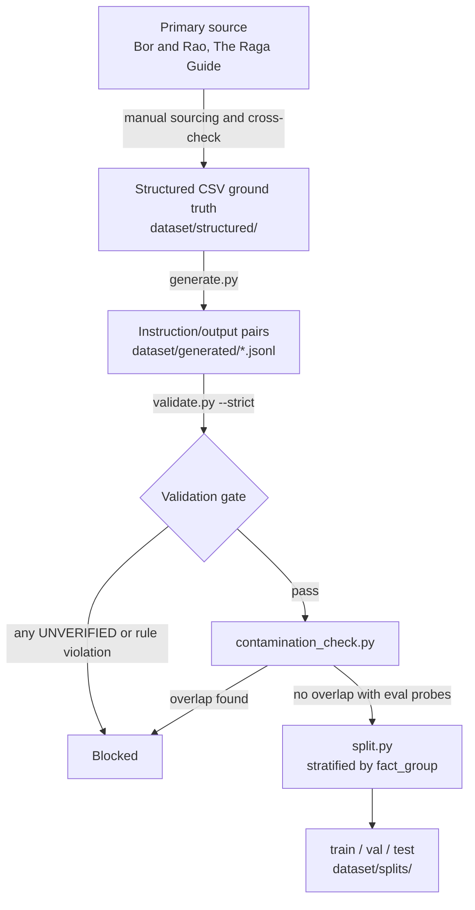
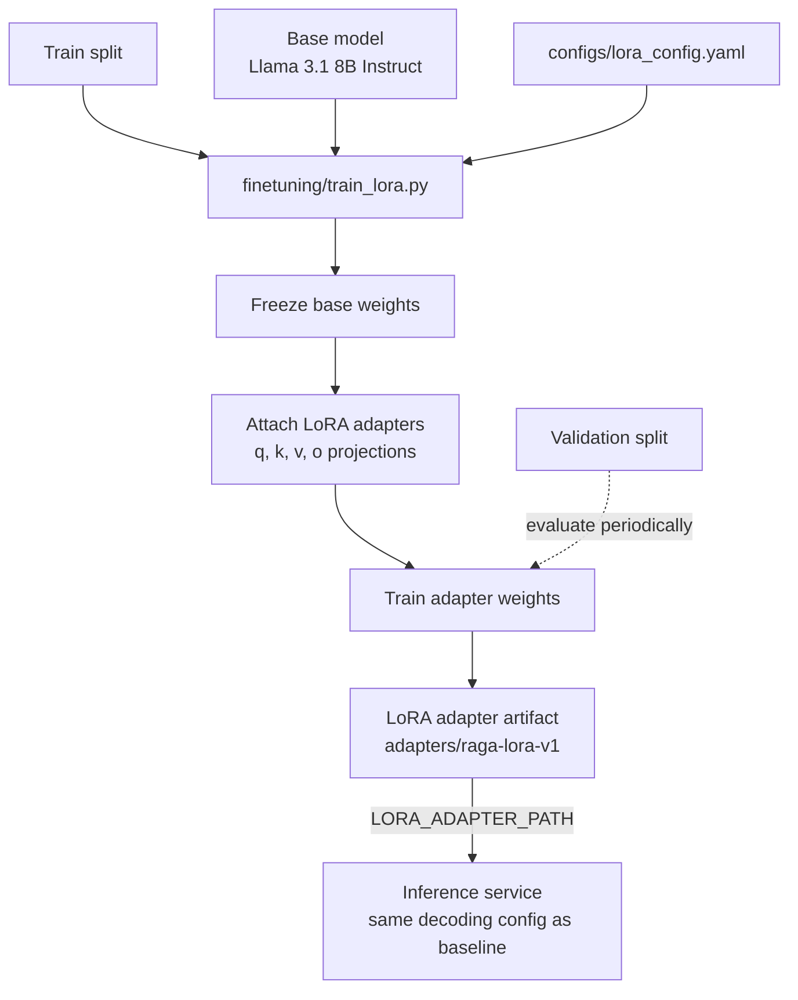
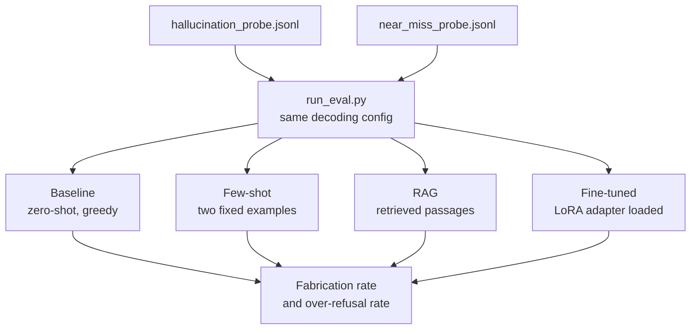
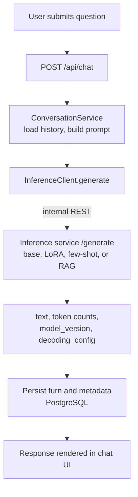

# RAGA Workflows

| | |
|---|---|
| Document | End-to-end workflows |
| Status | Draft v1.0 |
| Related | [PRD](PRD.md), [Architecture](ARCHITECTURE.md), [Dataset conventions](../dataset/docs/CONVENTIONS.md) |

## 1. Dataset Construction

| Stage | Input | Output | Gate |
|---|---|---|---|
| Ground truth | Primary source | `ragas.csv`, `concepts.csv`, `taals.csv` | One row per entity with fact, source, `contested`, `verification_status` |
| Generation | Verified rows | JSONL per category | Only `VERIFIED` rows are expanded (except the out-of-domain category) |
| Validation | Generated JSONL | Pass or fail | Swara notation, banned transliterations, length ranges, duplicates, fabricated citations, `UNVERIFIED` records |
| Contamination check | Generated JSONL, eval probes | Pass or fail | No evaluation probe question appears in training data |
| Split | Validated JSONL | Train, validation, test | Stratified by `fact_group` so related facts do not straddle splits |

The dataset covers ten categories, including `out_of_domain`, which teaches calibrated refusal.

## 2. LoRA Fine-Tuning

Initial hyperparameters (starting points for a small sweep on the validation split, not final values):

| Parameter | Value |
|---|---|
| Rank `r` / alpha / dropout | 16 / 32 / 0.05 |
| Target modules | `q_proj`, `k_proj`, `v_proj`, `o_proj` |
| Learning rate | 2e-4 |
| Epochs | 3 |
| Effective batch size | 16 (4 per device, 4 accumulation steps) |
| Precision | float16; 4-bit QLoRA fallback if VRAM is insufficient |

## 3. Evaluation (Four Conditions)

| Probe | Question type | Metric |
|---|---|---|
| Hallucination probe | Unanswerable or non-existent entities | Fabrication rate (confident answer instead of refusal) |
| Near-miss probe | Answerable questions close to refusal territory | Over-refusal rate (incorrect decline) |

The two rates are always reported together. A drop in fabrication that comes with a rise in over-refusal is not an improvement.

## 4. Runtime Chat

A sequence-level view is in [ARCHITECTURE.md](ARCHITECTURE.md), section 3.

## 5. Status

| Workflow | Status |
|---|---|
| Dataset construction (section 1) | Pipeline built and validated; entity research complete (125 ragas, 34 multi-thaat) |
| Baseline and decoding characterization | Complete and reproducible |
| LoRA fine-tuning (section 2) | Designed, not yet executed |
| Four-condition evaluation (section 3) | Harness ready; fine-tuned and RAG conditions require section 2 and a retrieval corpus |
| Runtime chat (section 4) | Application scaffolded; inference service currently serves the baseline only |

## 6. Workflow Risks

| Risk | Mitigation |
|---|---|
| Dataset volume (roughly 10,000 to 12,000) is small relative to typical fine-tuning corpora | Low LoRA rank and verified-only data, a deliberate trade of scale for correctness (see PRD non-goals) |
| RAG corpus and training data drift out of sync | Both are generated from the same `dataset/structured/` verified rows |
| Evaluation probe leakage into training data | `contamination_check.py` is a hard gate before any split is finalized |
